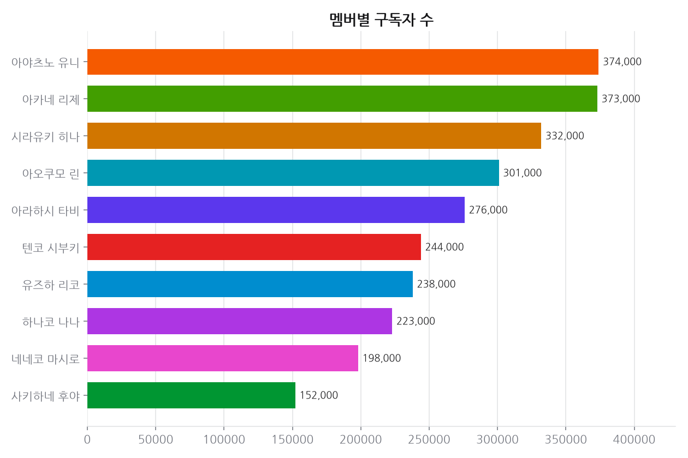
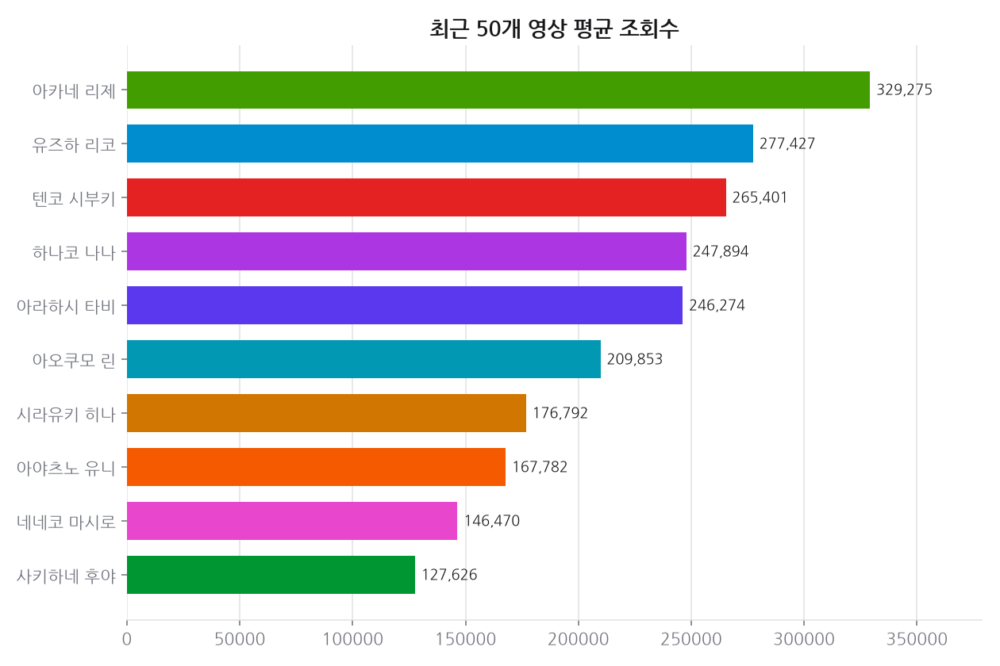
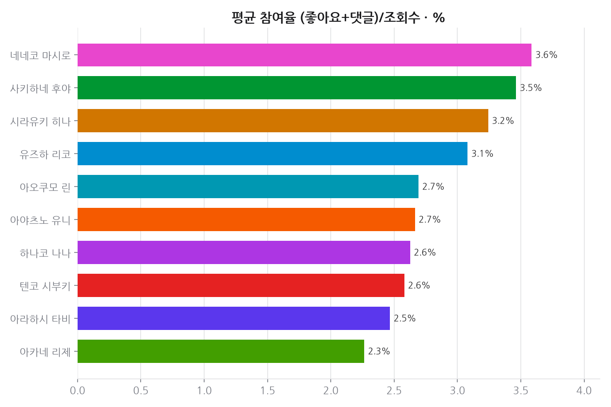
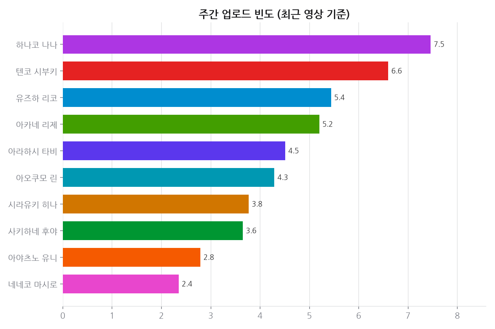
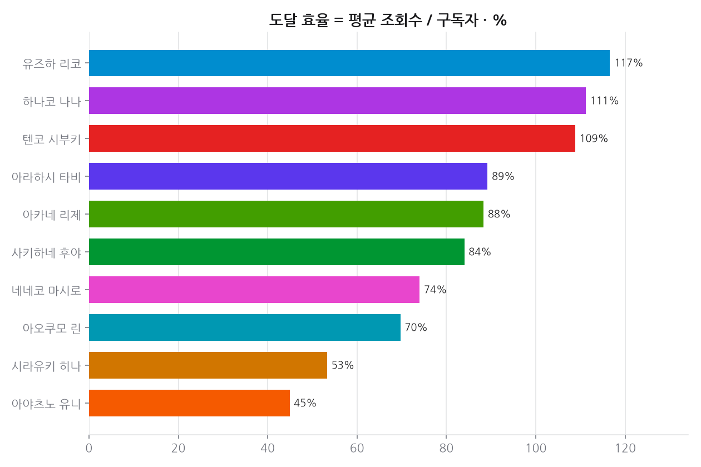
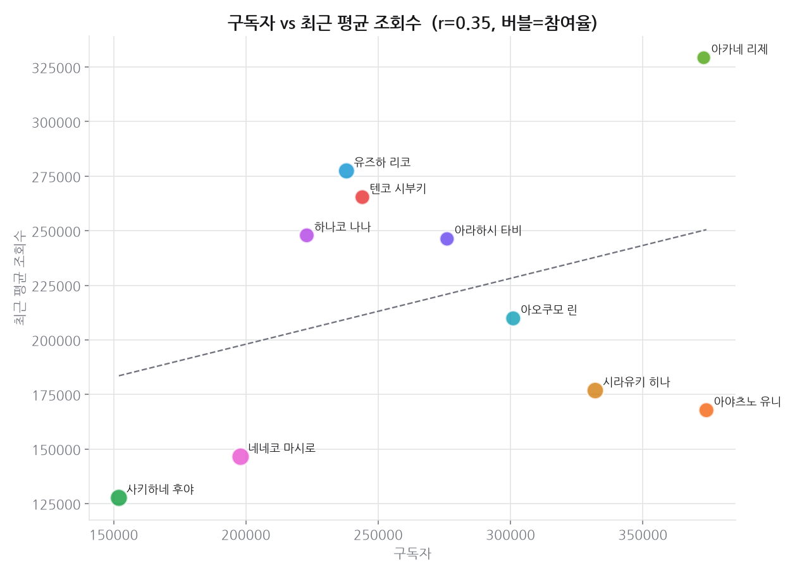
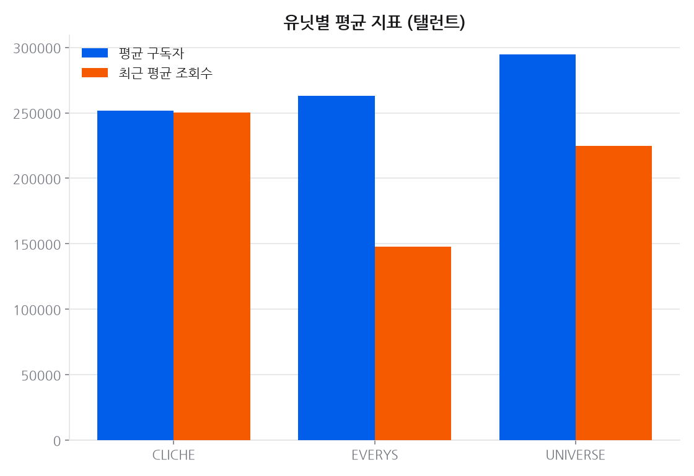
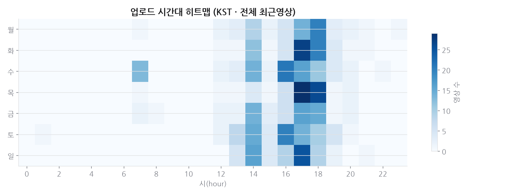

# 프로젝트 1 · 멤버별 유튜브 채널 성과

**기준 2026-10-26**  · 날짜별 축적

## 결론

규모와 밀도는 반대로 간다. 참여율과 구독자, 도달 효율과 구독자가 모두 **뚜렷한 음의 상관**이다. 구독자가 많은 채널일수록 구독자 대비 조회수와 참여율이 낮다 — 팬덤이 커질수록 느슨해진다는 뜻이다. 반면 업로드 빈도와 평균 조회수는 **뚜렷한 양의 상관**이라, 이 규모대에서는 물량이 조회수를 견인한다.

---

## 데이터

- 데이터 소스: YouTube Data API v3 (수집 2026-10-26)
- 대상: StelLive 탤런트 10명(최근 영상이 5개 미만이거나 구독자 수를 숨긴 채널 4개는 제외 — 시즈키 토아, 코가네 랑, 하나요 히요리, 토키노 메리), 채널당 최근 50개 영상
- 총 562개 영상 지표 집계

## 한눈에

- **구독자와 참여율**: 구독자 상위 3명과 참여율 상위 3명 중 겹치는 멤버는 1명이다.
- **구독자와 도달 효율**: 구독자 상위 3명과 도달 효율 상위 3명은 한 명도 겹치지 않는다.
- 구독자: 중앙값 260,000명 · 범위 152,000명~374,000명
- 도달 효율(평균조회수/구독자): 중앙값 86% · 범위 45%~117%
- 업로드: 중앙값 주 4.4회 · 범위 주 2.4회~주 7.5회
- 참여율(좋아요+댓글/조회수): 중앙값 2.7% · 범위 2.3%~3.6%
- 멤버별 수치는 아래 표·차트에 있다. 요약에는 멤버 이름을 붙인 순위를 쓰지 않는다.

## 시간에 따른 변화

### 추세 · 구독자

축적 70일 (기준 2026-10-26)

| 멤버 | 1일(1d) | 7일(7d) | 28일(29d) |
|---|---:|---:|---:|
| 사키하네 후야 | +0.66% | +2.01% | +11.76% |
| 네네코 마시로 | +0.51% | +1.54% | +7.03% |
| 유즈하 리코 | +0.42% | +1.28% | +6.25% |
| 아카네 리제 | +0.27% | +0.81% | +4.19% |
| 시라유키 히나 | +0.00% | +0.61% | +3.43% |
| 아라하시 타비 | +0.00% | +1.10% | +4.94% |
| 아야츠노 유니 | +0.00% | +0.54% | +3.31% |
| 아오쿠모 린 | +0.00% | +1.01% | +5.24% |
| 텐코 시부키 | +0.00% | +1.24% | +5.63% |
| 하나코 나나 | +0.00% | +1.36% | +6.70% |

> 유튜브 구독자는 API 가 1,000 단위로 반올림해 준다. 작은 채널은 하루에 0 또는 +1,000 으로만 움직여 짧은 창에서는 `+0.00%` 로 찍힌다. 실제로 안 늘어난 것이 아니라 반올림 경계를 안 넘은 것이다 — 짧은 구간은 치지직 팔로워(정확한 정수)를 같이 보는 편이 낫다.

## 상세 분석

### 상관관계 (탤런트 10명)

| 관계 | 상관계수 r |
|------|-----------|
| 구독자 ↔ 최근 평균 조회수 | 0.346 |
| 업로드 빈도 ↔ 구독자 | -0.119 |
| 업로드 빈도 ↔ 평균 조회수 | 0.717 |
| 참여율 ↔ 구독자 | -0.598 |
| 도달 효율 ↔ 구독자 | -0.509 |

> 해석 힌트: 구독자와 평균 조회수의 상관이 높으면 "구독자 규모가 조회수를 견인",
> 도달 효율↔구독자 상관이 음수면 "소규모 채널일수록 구독자 대비 조회수가 높은"
> (덜 포화된) 경향으로 읽을 수 있습니다.

## 근거 자료

### 차트 8종 (최신 실행 2026-10-26 기준)

