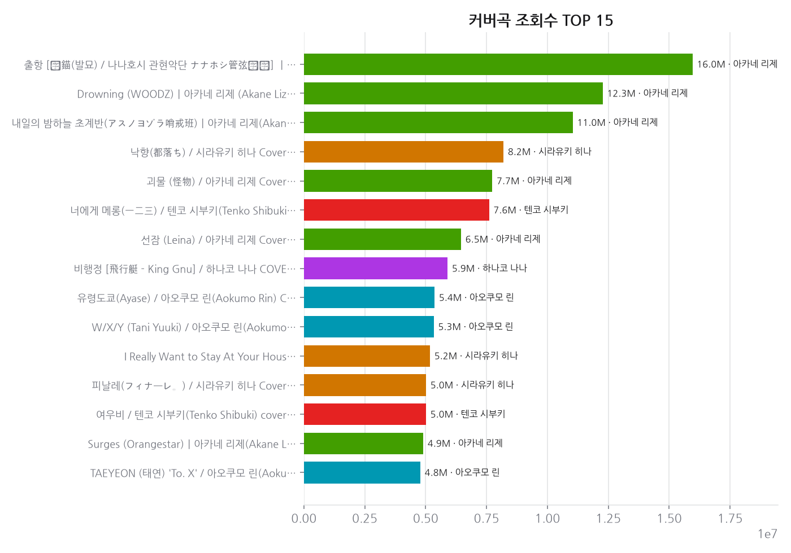
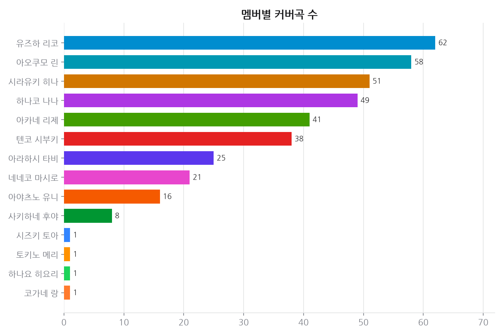
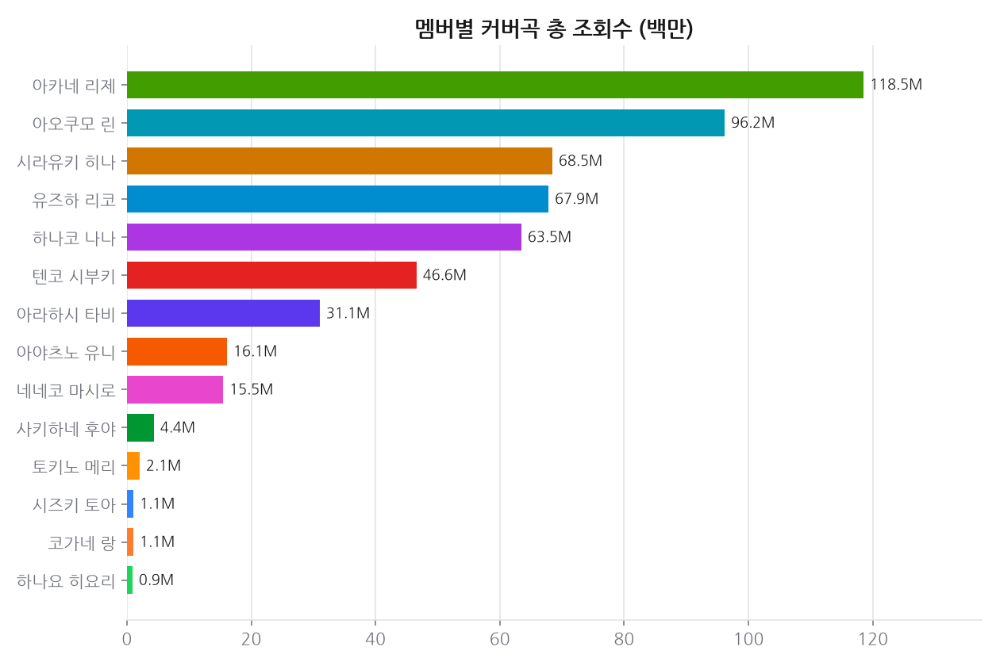
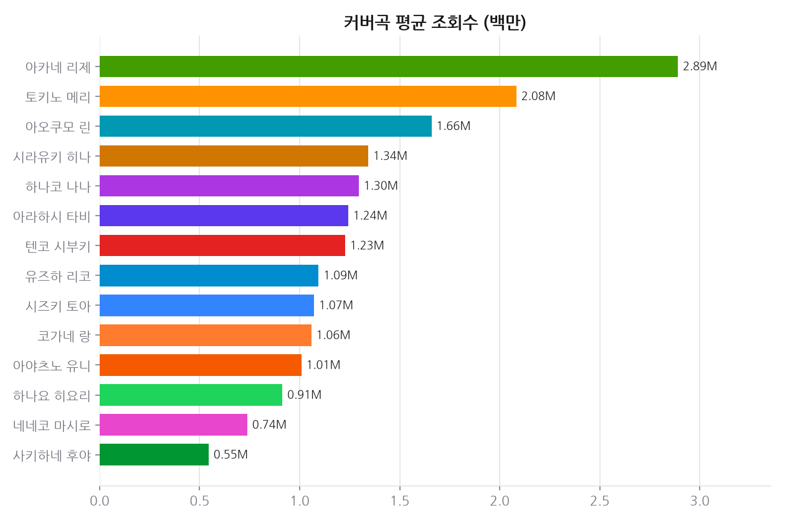
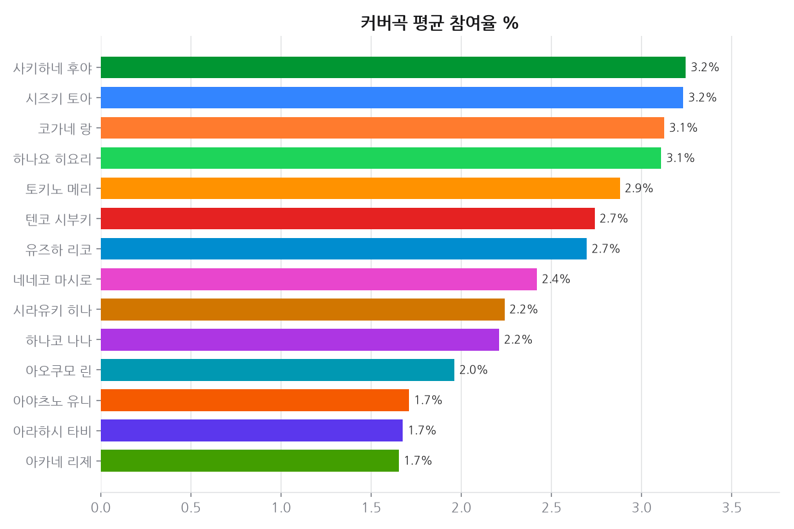
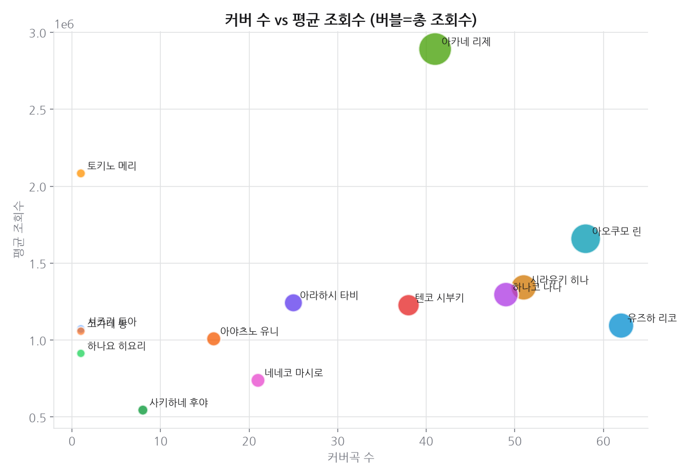
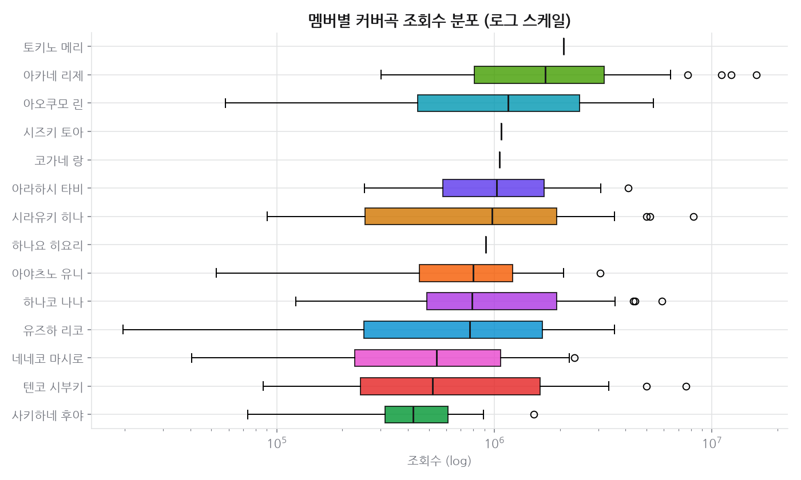

# 프로젝트 2 · 커버곡 성과 랭킹

**기준 2026-10-23**  · 날짜별 축적

## 결론

커버곡은 업로드 수와 성과가 그대로 비례하지 않는다. 곡 수 상위 멤버와 총 조회수·곡당 조회수 상위 멤버가 일부만 겹친다. 즉 커버곡에서는 **어떤 곡을 고르느냐가 몇 곡을 올리느냐만큼 크게 작용한다.** 다만 프로젝트 1에서 업로드 빈도가 조회수를 견인한 것과는 방향이 달라, 콘텐츠 종류에 따라 물량 전략의 효과가 갈린다고 읽어야 한다.

---

## 데이터

- 데이터 소스: YouTube Data API v3 (채널 검색 + 영상 지표), 수집 2026-10-23
- 멤버 15명 · 커버 영상 399개 = 곡 346곡
  (여러 판으로 올라온 곡 26곡)
- Topic 채널 음원 판: 트랙 48개 중 커버와 짝지어진 것 0개
  (짝이 둘 이상이라 안 붙인 것 0개). 나머지는 오리지널곡 음원이라 12에서 쓴다.

## 한눈에

- **곡 수와 총 조회수**: 곡 수 상위 3명과 총 조회수 상위 3명 중 겹치는 멤버는 2명이다.
- **곡 수와 영상당 평균 조회수**: 곡 수 상위 3명과 영상당 평균 조회수 상위 3명 중 겹치는 멤버는 1명이다.
- 멤버별 곡 수: 중앙값 22곡 · 범위 1곡~57곡
- 멤버별 총 조회수: 중앙값 23.6M · 범위 0.9M~118.5M
- 멤버별 영상당 평균 조회수: 중앙값 1.16M · 범위 0.55M~2.89M
- 역대 최고 조회 커버: 「출항 [抜錨(발묘) / 나나호시 관현악단 ナナホシ管弦楽団] ㅣ아카네 리제(Akane Lize) 【COVER】」 — 16.0M
- 멤버별 수치는 아래 표·차트에 있다. 요약에는 멤버 이름을 붙인 순위를 쓰지 않는다.

## 시간에 따른 변화

### 추세 · 커버 총 조회수

축적 67일 (기준 2026-10-23)

| 멤버 | 1일(1d) | 7일(7d) | 28일(28d) |
|---|---:|---:|---:|
| 토키노 메리 | +13.67% | +907.96% | +nan% |
| 시즈키 토아 | +8.07% | +252.91% | +nan% |
| 하나요 히요리 | +6.31% | +207.84% | +nan% |
| 코가네 랑 | +4.61% | +307.68% | +nan% |
| 사키하네 후야 | +2.12% | +4.38% | +11.18% |
| 텐코 시부키 | +0.30% | +2.22% | +6.70% |
| 아라하시 타비 | +0.25% | +2.33% | +7.34% |
| 유즈하 리코 | +0.25% | +1.97% | +6.95% |
| 아오쿠모 린 | +0.24% | +1.73% | +7.65% |
| 하나코 나나 | +0.23% | +1.64% | +7.03% |
| 아카네 리제 | +0.22% | +1.32% | +5.65% |
| 시라유키 히나 | +0.19% | +1.34% | +4.56% |
| 아야츠노 유니 | +0.17% | +1.18% | +5.66% |
| 네네코 마시로 | +0.13% | +0.91% | +3.85% |

## 상세 분석

### 조회수를 세는 법 — 한 곡은 한 곡으로

한 곡이 본편 MV·[4K]·3D 라이브·쇼츠·티저로 여러 번 올라온다. 여기에 유튜브가 유통사 배급분으로
자동 생성하는 **"<이름> - Topic" 채널의 음원 판**이 따로 있다(예: 마시로 '봄꿈' MV ↔ Neneko
Mashiro - Topic 'Springdream'). 그래서:

- **총 조회수(total_views)** = 멤버 채널에 올라온 커버 영상 전부의 합. 여러 판이면 다 더한다.
- **음원 포함(total_views_incl_topic)** = 위 + 같은 멤버·발매일 ±3일 안에서 **제목까지 맞는** Topic
  트랙 조회수(반주 판 제외). Topic 트랙은 대부분 오리지널곡 음원이라 커버에 붙는 건 드물다 —
  날짜만 맞는 것은 붙이지 않는다(같은 날 나온 오리지널이 커버에 붙는 사고를 막기 위해).
- **곡 수(song_count)** 는 판을 한 곡으로 묶은 수, **영상 수(cover_count)** 는 그대로 센 수.

## 근거 자료

### 차트 7종 (최신 실행 2026-10-23 기준)

