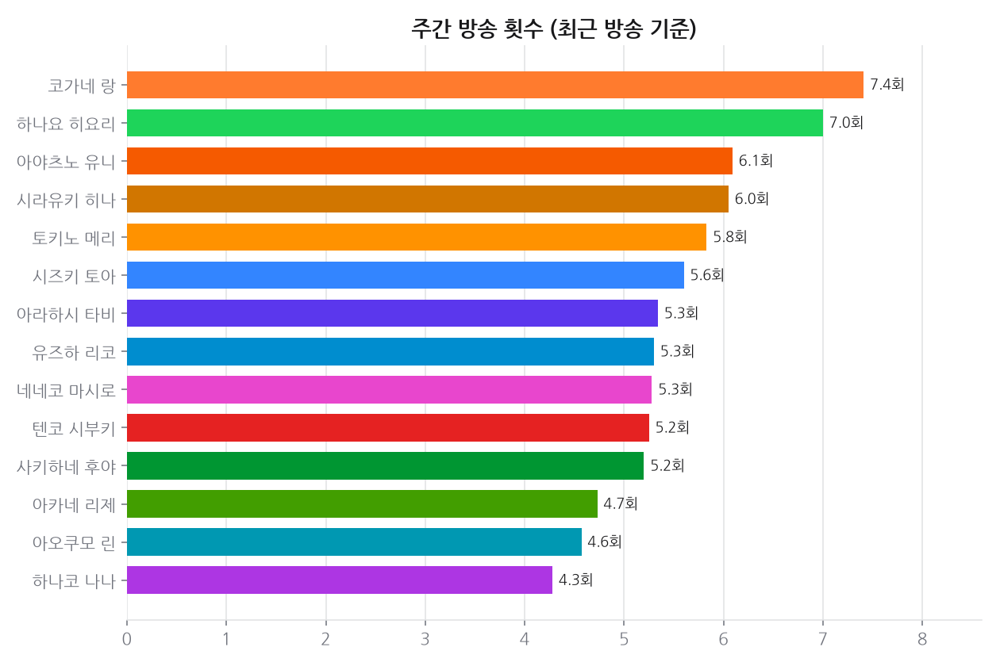
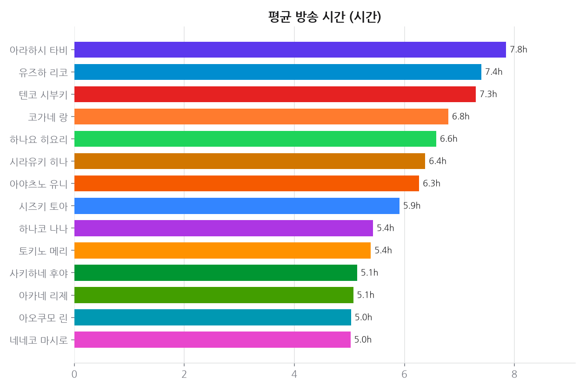
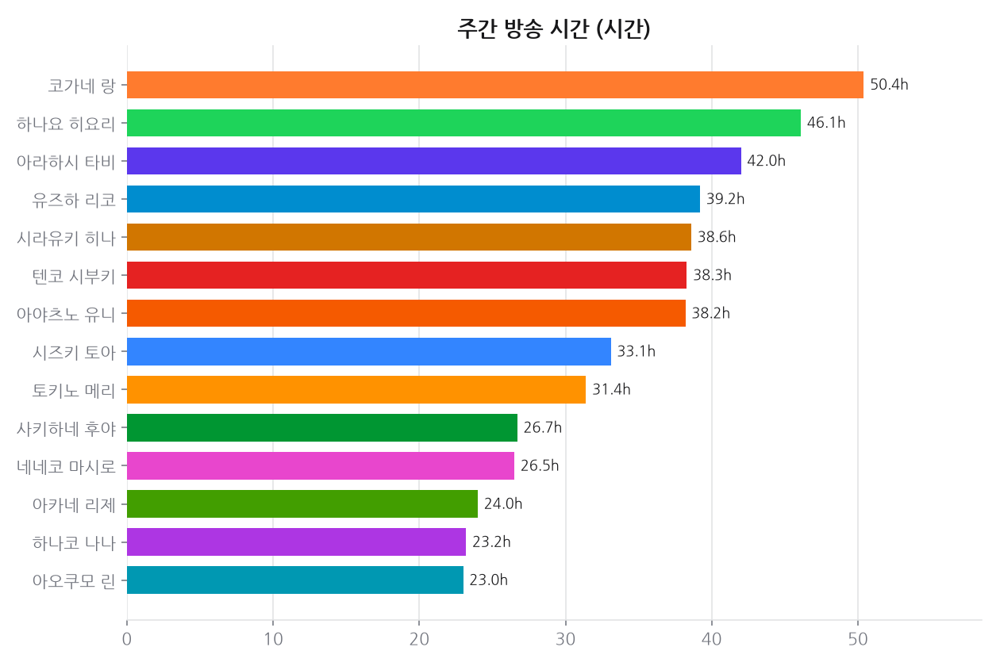
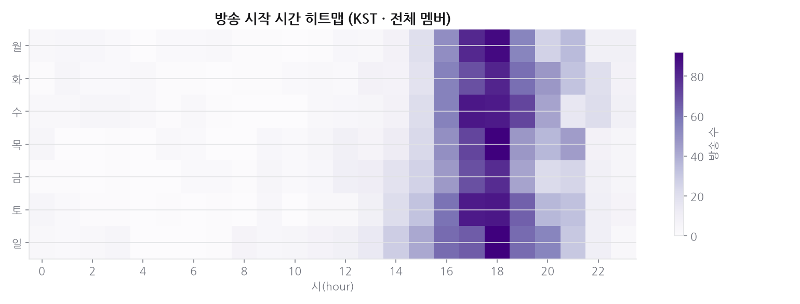
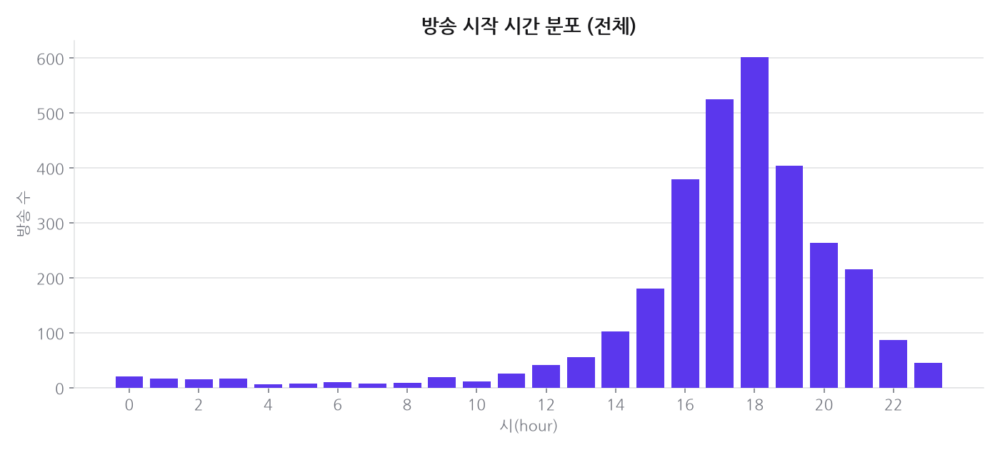
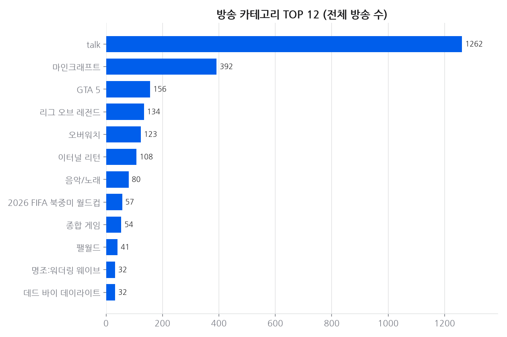
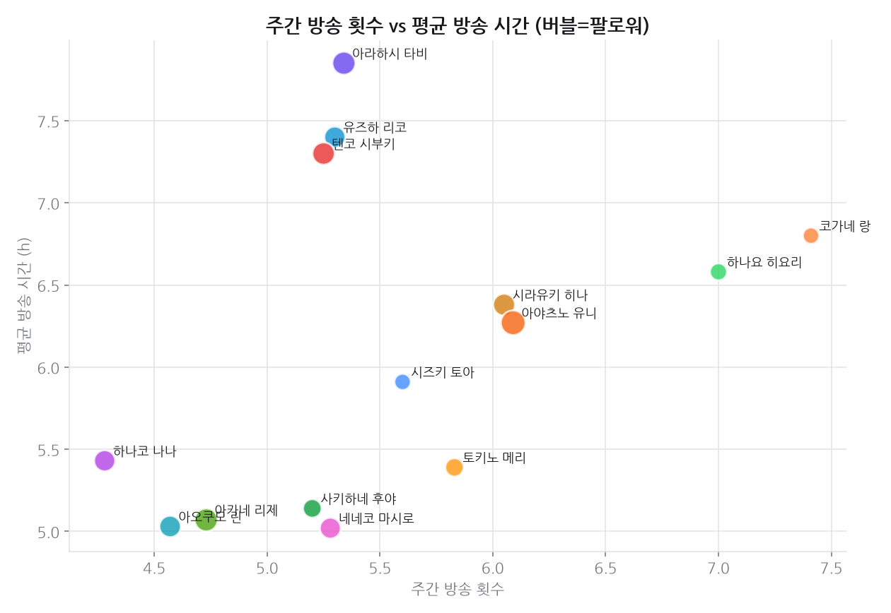
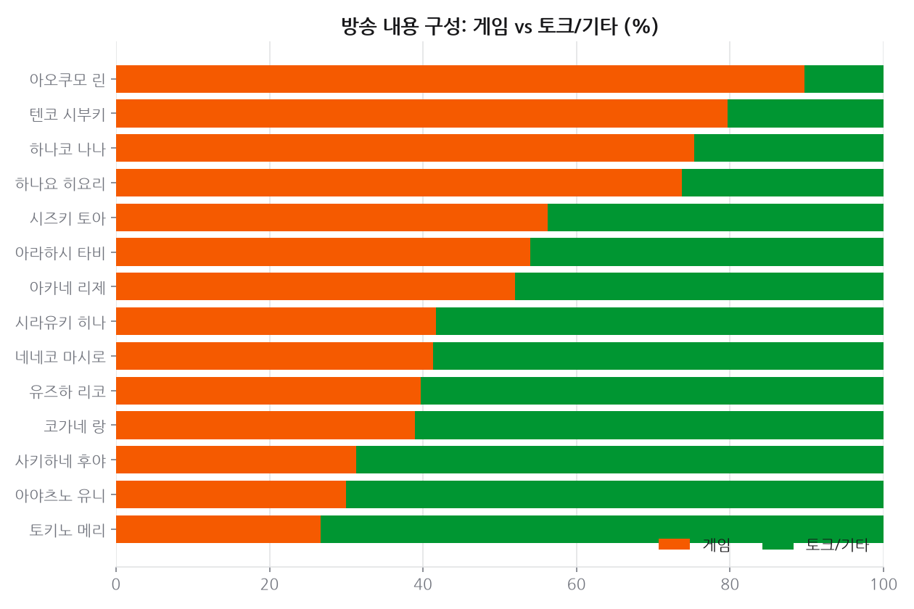

# 프로젝트 3 · 치지직 방송 패턴

**기준 2026-11-07**  · 날짜별 축적

## 결론

방송은 대부분 **오후~저녁에 시작해 자정 무렵에 끝난다.** 심야(0~5시) 시작은 예외다 — 2026-10-19 전까지는 다시보기 게시 시각(=방송 종료)을 시작으로 잘못 세어 '새벽 시작이 기본값'으로 읽혔다. 주간 방송 시간이 긴 멤버와 자주 하는 멤버가 대체로 달라 '길게 적게'와 '짧게 자주'가 공존하고, 게임 대 토크 비중도 멤버마다 갈려 이 그룹에는 단일한 방송 공식이 없다.

---

## 데이터

- 데이터 소스: 치지직(Chzzk) 비공식 API — 다시보기(VOD replay) 3068건, 수집 2026-11-07
- 멤버 14명, 멤버당 최근 최대 300개 방송
- 방송 시각은 **시작 시각**(다시보기 게시 시각 − 방송 길이)이다. 2026-10-19 전까지는 게시 시각(=방송 종료)을
  시작으로 써서 시작 시각·심야 비율이 방송 길이만큼 늦게 잡혀 있었다 — 그 전 `history.csv` 의 `night_share` 와 비교하지 말 것.

## 한눈에

- **방송 시간과 방송 빈도**: 주간 방송 시간 상위 3명과 방송 빈도 상위 3명 중 겹치는 멤버는 2명이다.
- 주간 방송 시간: 중앙값 주 36시간 · 범위 주 23시간~주 50시간
- 회당 평균 방송: 중앙값 6.1시간 · 범위 5.0시간~7.8시간
- 방송 빈도: 중앙값 주 5.3회 · 범위 주 4.3회~주 7.4회
- 심야(0~5시) 시작 비율: 중앙값 2% · 범위 0%~19%
- 전체 방송이 가장 많이 시작되는 시간대: **18시** (KST)

## 시간에 따른 변화

### 추세 · 치지직 팔로워

축적 82일 (기준 2026-11-07)

| 멤버 | 1일(1d) | 7일(7d) | 28일(28d) |
|---|---:|---:|---:|
| 코가네 랑 | +1.05% | +2.96% | +nan% |
| 하나요 히요리 | +0.56% | +3.84% | +nan% |
| 토키노 메리 | +0.48% | +3.27% | +nan% |
| 시즈키 토아 | +0.37% | +2.53% | +nan% |
| 아카네 리제 | +0.20% | +0.68% | +4.92% |
| 유즈하 리코 | +0.17% | +0.80% | +6.08% |
| 하나코 나나 | +0.16% | +0.89% | +7.18% |
| 아라하시 타비 | +0.12% | +0.67% | +5.06% |
| 시라유키 히나 | +0.11% | +0.55% | +4.51% |
| 네네코 마시로 | +0.11% | +0.59% | +5.74% |
| 사키하네 후야 | +0.10% | +0.90% | +7.70% |
| 아오쿠모 린 | +0.08% | +0.63% | +5.45% |
| 텐코 시부키 | +0.06% | +0.54% | +4.83% |
| 아야츠노 유니 | +0.03% | +0.26% | +3.74% |

## 근거 자료

### 차트 8종 (최신 실행 2026-11-07 기준)

