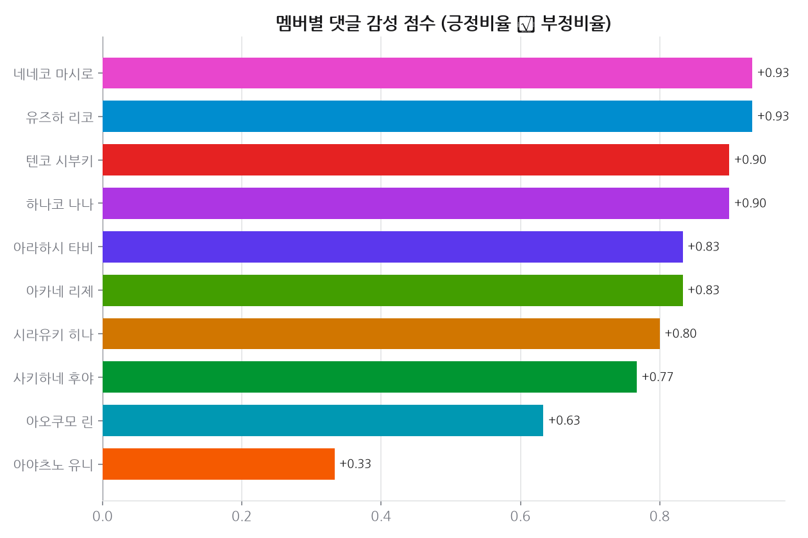
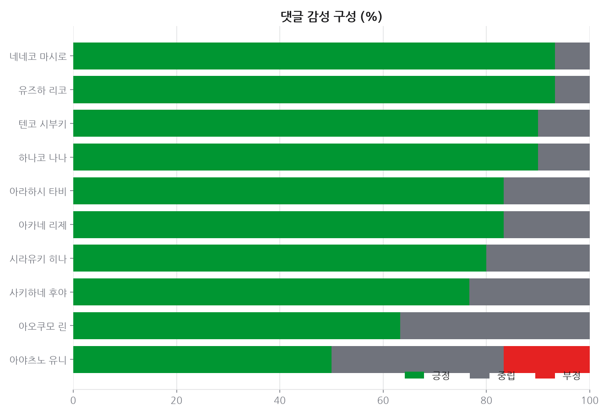
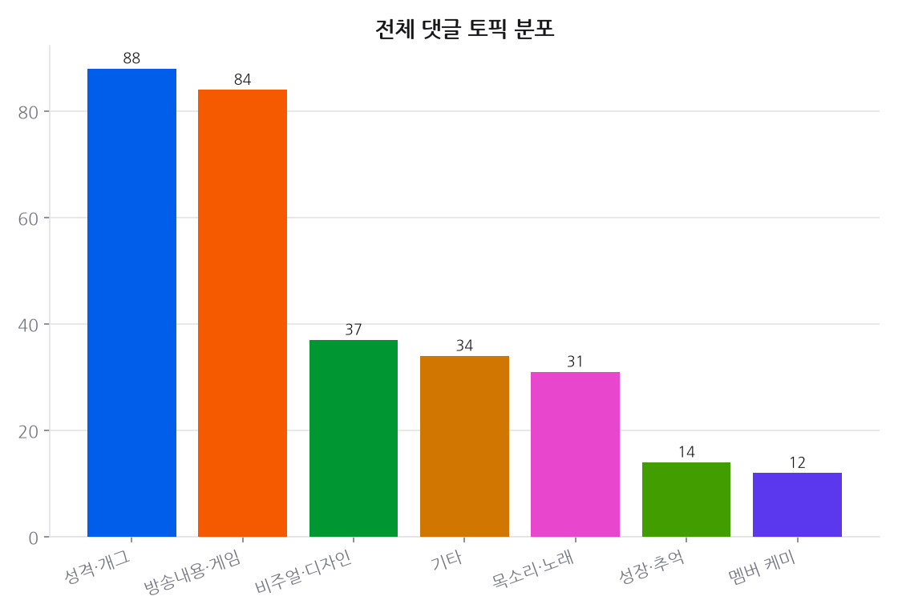
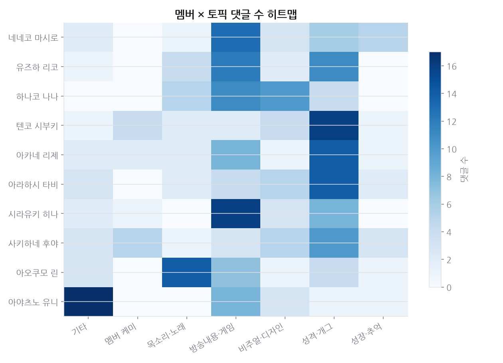

# 프로젝트 5 · 댓글 여론/감성

**기준 2026-10-17**

## 결론

상위 댓글은 **대부분 긍정**이다(비율은 핵심 요약에). 다만 이건 '팬덤이 화목하다'가 아니라 **표본의 성격**으로 읽어야 한다. 유튜브 추천순 상위 댓글은 좋아요를 많이 받은 것들이고, 팬 커뮤니티에서 좋아요를 모으는 건 대체로 애정 표현이다. 부정 여론이 없다는 근거로는 쓸 수 없다. 토픽 분포에서는 성격·개그가 목소리·노래를 앞서, 팬들이 콘텐츠보다 **사람**에 반응한다.

---

## 데이터

- 데이터: 멤버별 인기 영상의 상위(추천순) 댓글에서 멤버당 좋아요 상위 30개를 뽑아
  **Claude(본 세션)** 가 직접 읽고 감성(긍정/중립/부정)·토픽 7종으로 분류. 순위·비율은 멤버 10명의
  표본 300개 기준, 표본 구성이 다른 4명(시즈키 토아, 코가네 랑, 토키노 메리, 하나요 히요리)은 아래 '따로 보는 멤버'에 적고 순위에 넣지 않음.
- 수집 2026-10-17

## 한눈에

- 표본 전체 긍정 비율 **80%** — 상위 댓글은 대부분 팬 애정 표현.
- 멤버별 감성 점수(긍정 비율−부정 비율): 중앙값 +0.83 · 범위 +0.33~+0.93.
  긍정이 부정보다 많은 멤버는 10/10명 — 멤버별 수치는 아래 표에 있다.
- 가장 많이 언급되는 토픽: **성격·개그**
- 멤버×토픽 히트맵에서 목소리·노래, 성격·개그가 대다수 멤버의 상위 토픽으로 나타남.

## 상세 분석

### 방법론 & 한계

- 댓글은 유튜브 `order=relevance`(추천순) 상위 표본 — 실제 시청자에게 가장 잘 보이는 댓글이며,
  전체 댓글의 무작위 표본은 아님(추천 알고리즘이 긍정/재치있는 댓글을 우선 노출하는 경향 있음).
- 라벨링은 규칙 기반이 아닌 Claude의 문맥 판단(반어법·팬덤 용어 고려)으로 수행.
- 라벨링한 표본은 라벨링 당시의 수집분이다. 원천 댓글(`comments_raw.csv`)은 주마다 새로 받지만 표본과 라벨은
  다시 뽑을 때까지 그대로다.

### 따로 보는 멤버 — 표본 구성이 달라 순위에 넣지 않음

표본 영상이 3개 미만인 멤버는 순위·전체 비율·히트맵에서 뺀다. 4기 ABYSS 는 아직 영상이 데뷔
커버곡 하나뿐이라 30개 댓글이 모두 그 노래에 대한 반응이다 — 토픽이 노래로 쏠리고 긍정이 높게 나오는 게
당연해서, 인기 영상 4개에서 뽑은 다른 멤버와 나란히 놓으면 멤버 차이가 아니라 표본 차이를 재게 된다.
영상이 쌓이면 같은 기준으로 다시 뽑아 라벨링해야 순위에 들어간다.

| 멤버 | 표본 영상 | 댓글 | 긍정 | 부정 | 주요 토픽 |
|---|---|---|---|---|---|
| 시즈키 토아 | 1개 | 30 | 100% | 0% | 목소리·노래 (24/30) |
| 코가네 랑 | 1개 | 30 | 77% | 0% | 목소리·노래 (9/30) |
| 토키노 메리 | 1개 | 30 | 100% | 0% | 목소리·노래 (25/30) |
| 하나요 히요리 | 1개 | 30 | 97% | 0% | 목소리·노래 (18/30) |

## 근거 자료

### 차트 4종 (최신 실행 2026-10-17 기준)

