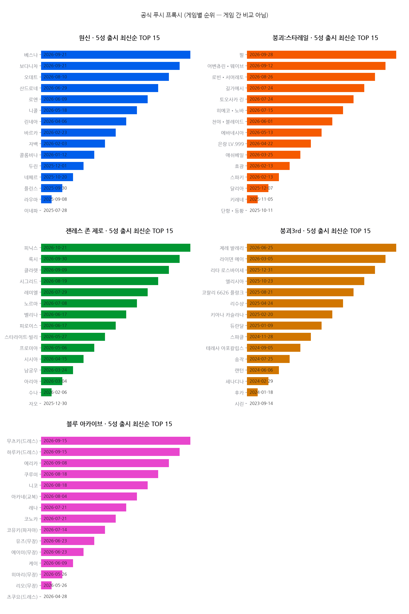
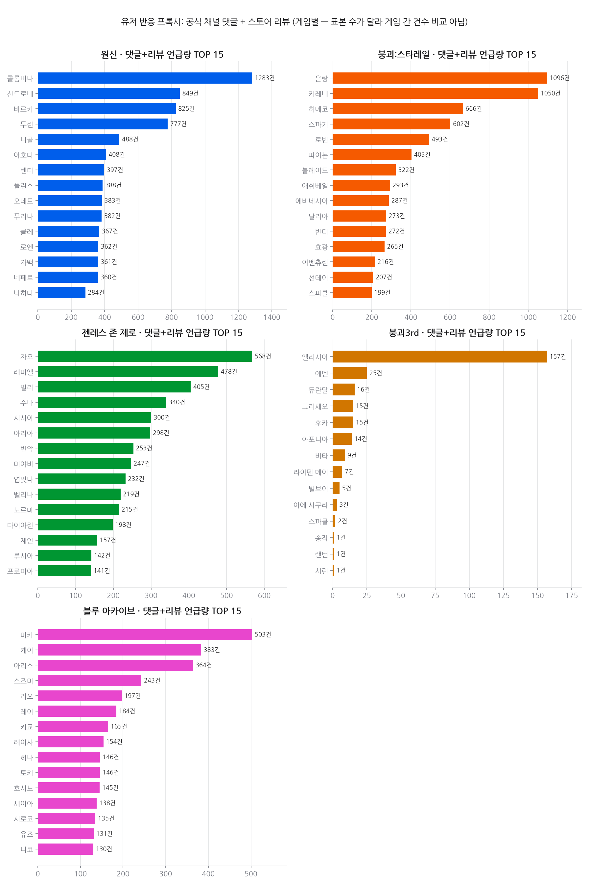
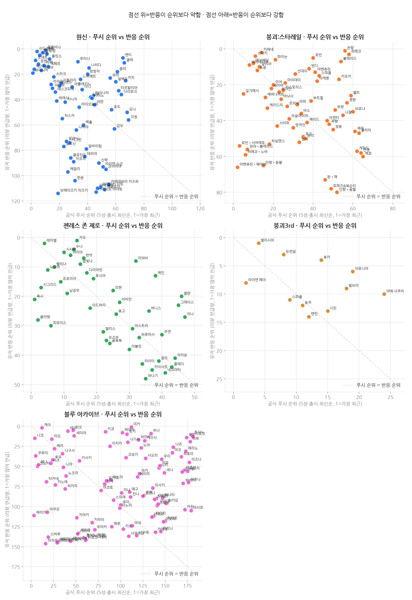
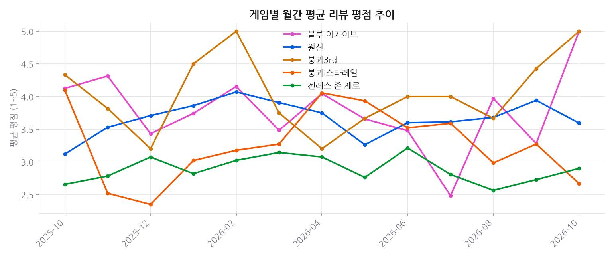
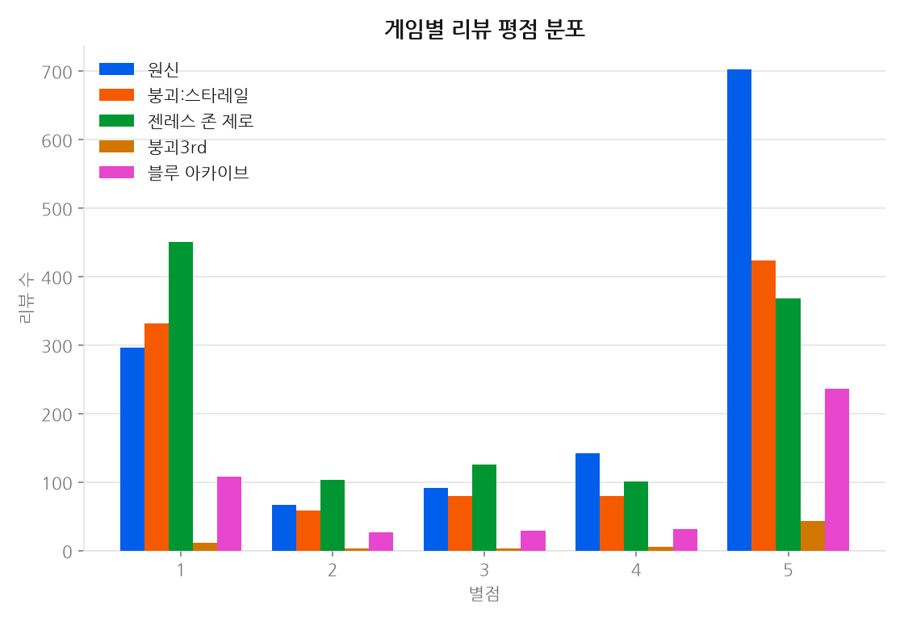
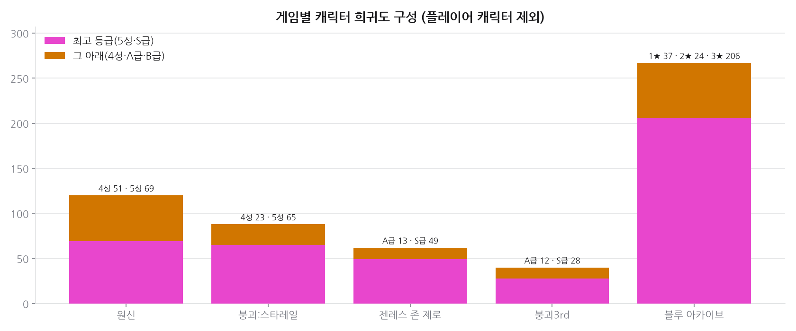
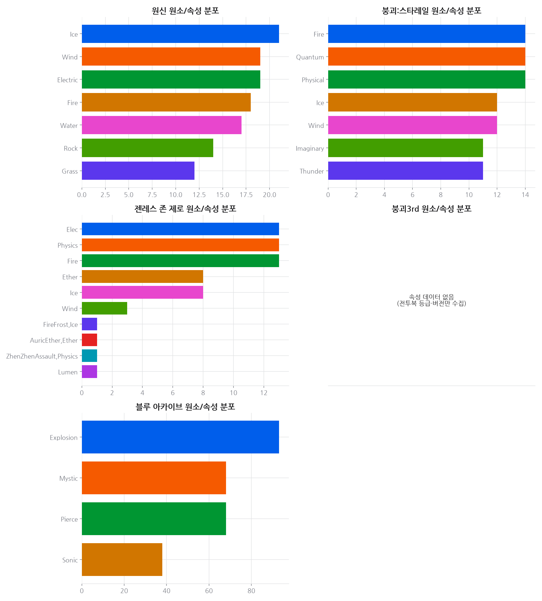
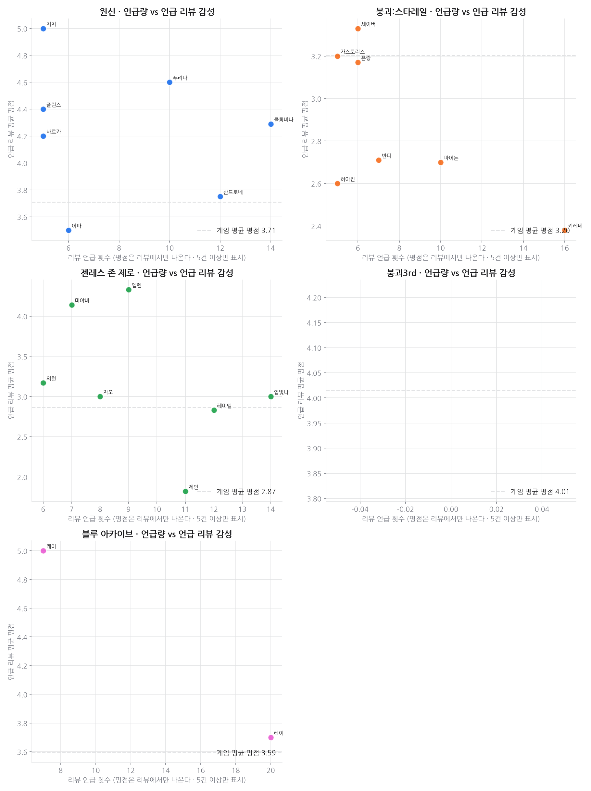

# 프로젝트 10 · 게임 캐릭터 인기도

**기준 2026-10-24**

## 결론

게임사가 미는 캐릭터와 유저가 반응하는 캐릭터가 **다르다.** 원신·붕괴:스타레일·젠레스 존 제로·붕괴3rd·블루 아카이브를 각각 따로 봐도 공식 푸시 1위(최신 최고 등급)와 언급량(공식 채널 댓글+리뷰) 1위가 다섯 게임 모두 일치하지 않고, 반응 상위에는 출시가 오래된 캐릭터가 꾸준히 올라온다. 순위·격차는 **게임 안에서만** 매기고 **리뷰 기간만 같은 창(최근 1년)** 으로 맞춘다 — 건수는 게임마다 다르고, 붕괴3rd 는 한 해 리뷰가 두 자릿수라 언급 순위가 사실상 서지 않는다는 것까지 결과다. 어떤 소스에서도 언급되지 않는 캐릭터가 게임마다 있어(비율은 게임별 요약에), 언급량은 '인기'가 아니라 **'화제성'** 의 근사치로만 읽어야 한다. Google Trends 는 실행마다 실제로 호출하고 결과를 상태 파일로 남긴다.

---

## 데이터

**질문**: 게임사가 밀어주는 캐릭터와 유저가 실제로 반응하는 캐릭터는 일치하는가?

- 데이터 소스: 캐릭터 마스터 — 원신·붕괴:스타레일 yatta.moe / 젠레스 존 제로 Enka.Network 저장소 +
  Fandom 위키(출시일) / 붕괴3rd Fandom 위키(전투복·버전) + 수동 한글 표. 리뷰 — 한국 Google Play.
- **수집 기간은 다섯 게임 모두 같다**: 수집 시점부터 365일
  (2025-10-24 ~ 2026-10-24). 건수는 게임마다 다르다 —
  원신 1,245건 · 붕괴:스타레일 961건 · 젠레스 존 제로 1,131건 · 붕괴3rd 68건 · 블루 아카이브 414건.
- **유저 반응은 한국어 텍스트 167,381건**에서 센다 — 구글 플레이 리뷰,
  애플 앱스토어 리뷰, 공식 한국 유튜브 채널 댓글, HoYoLAB 한국어 글의 댓글. 플레이 리뷰만 쓰던 때는
  캐릭터당 언급이 한 자릿수~십몇 건이라 순위가 한두 건 차이로 뒤집혔다. 접근 가능한 소스를 전부
  시험해 되는 것만 썼고, 막힌 곳(arca.live·dcinside·reddit 등)은 `data/source_probe.json` 에
  이유와 함께 남겼다. 대신 **공식 채널·HoYoLAB 댓글은 그 게임을 이미 보는 사람의 말**이라
  스토어 리뷰보다 호의적으로 기울 수 있다. 평점은 스토어 리뷰에서만 나온다.
- 수집 2026-10-24 · 가챠 캐릭터 원신 120명 · 붕괴:스타레일 88명 · 젠레스 존 제로 62명 · 붕괴3rd 40명 · 블루 아카이브 267명 (플레이어 캐릭터
  26명 제외) · 리뷰 3,819건
- **Google Trends 호출 성공** — 시험 질의("Genshin Impact", 1개월)가 31행을 받았다. 다만 **캐릭터 단위 검색 관심도는 아직 분석에 넣지 않았다** — 유저 반응 지표는 댓글+리뷰 언급량이다. 이 줄은 소스가 살아 있다는 기록이지 분석에 썼다는 뜻이 아니다.

## 상세 분석

### 표본 — 무엇을 세었나

| 게임 | 플레이 리뷰 | 애플 리뷰 | 공식 유튜브 댓글 | HoYoLAB 댓글 | 전체 | 공통 표본 |
|---|---:|---:|---:|---:|---:|---:|
| 원신 | 1,245 | 806 | 47,683 | 9,613 | 59,347 | 49,734 |
| 붕괴:스타레일 | 961 | 372 | 31,532 | 9,774 | 42,639 | 32,865 |
| 젠레스 존 제로 | 1,131 | 303 | 32,125 | 4,290 | 37,849 | 33,559 |
| 붕괴3rd | 68 | 22 | 2,345 | 134 | 2,569 | 2,435 |
| 블루 아카이브 | 414 | 156 | 24,407 | — | 24,977 | 24,977 |

모두 같은 기간(365일, 2025-10-24 ~ 2026-10-24)에 쓰인 한국어 텍스트다. 접근을 시험했지만 막힌 곳은 `data/source_probe.json` 에 이유와 함께 남겼다.

**게임끼리 비교할 때는 공통 표본만 쓴다.** 다섯 게임이 모두 가진 소스는 플레이 리뷰·애플 리뷰·
공식 유튜브 댓글 셋이다. HoYoLAB 은 호요버스 4개에만 있어 블루 아카이브와 견줄 수 없으므로
게임 간 수치에서는 뺀다. 게임 **안에서의** 순위는 그 게임의 모든 캐릭터가 같은 표본을 보므로
전체 표본(HoYoLAB 포함)을 쓴다. 두 값은 `mentions_total`(게임 안) 과
`mentions_common_per_10k`(게임 간)로 나눠 저장한다.

### 게임은 따로 본다

다섯 게임은 출시 주기·캐릭터 풀·표본 수가 다르다. 그래서 **순위(푸시·반응)와 격차는 게임
안에서만 매기고**, 게임을 가로지르는 순위표는 만들지 않는다. 아래 요약과 차트의 모든 순위는
그 게임 안에서의 순위다. 비교할 수 있게 맞춘 것은 **수집 기간** 하나다.

### 게임별 핵심 요약

### 원신

- 가챠 캐릭터 120명 · 한국어 표본 플레이 리뷰 1,245건 · 공식 채널 댓글 47,683건 · 애플 리뷰 806건 · HoYoLAB 댓글 9,613건 = **59,347건**
- **공식 푸시 1위**(최고 등급·최신 출시): 보댜니차 (2026-09-21 출시)
- **유저 반응 1위**(전체 언급): 콜롬비나 (유튜브 1,215 + HoYoLAB 10 + 애플 22 + 플레이 14 = 1,261건, 언급 리뷰 평점 4.3 / 게임 평균 3.7)
- 언급량은 **호불호를 가리지 않는 화제성**이다. 싫어서 쓴 리뷰도 언급이다. 언급 리뷰 평점이 게임 평균보다
  낮으면 부정 화제로 읽는다(각 항목의 평점 참고).
- 매칭 가능한 118명 중 **4명은 댓글·리뷰 어디에서도 언급되지 않았다**
- 많이 밀렸는데 반응이 약한 쪽: 보댜니차(푸시 1위→반응 17위, 언급 232건, 언급 리뷰 평점 5.0), 베스나(푸시 2위→반응 13위, 언급 284건, 언급 리뷰 평점 4.0), 로엔(푸시 5위→반응 9위, 언급 364건, 언급 리뷰 평점 5.0)
- 덜 밀렸는데 반응이 강한 쪽: 벤티(푸시 65위→반응 6위, 언급 425건, 언급 리뷰 평점 5.0), 클레(푸시 66위→반응 11위, 언급 353건), 종려(푸시 61위→반응 16위, 언급 258건, 언급 리뷰 평점 3.3)

### 붕괴:스타레일

- 가챠 캐릭터 88명 · 한국어 표본 플레이 리뷰 961건 · 공식 채널 댓글 31,532건 · 애플 리뷰 372건 · HoYoLAB 댓글 9,774건 = **42,639건**
- **공식 푸시 1위**(최고 등급·최신 출시): 펄 (2026-09-28 출시)
- **유저 반응 1위**(전체 언급): 은랑 (유튜브 1,076 + HoYoLAB 8 + 애플 6 + 플레이 6 = 1,096건, 언급 리뷰 평점 3.2 / 게임 평균 3.2)
- 언급량은 **호불호를 가리지 않는 화제성**이다. 싫어서 쓴 리뷰도 언급이다. 언급 리뷰 평점이 게임 평균보다
  낮으면 부정 화제로 읽는다(각 항목의 평점 참고).
- 매칭 가능한 87명 중 **8명은 댓글·리뷰 어디에서도 언급되지 않았다**
- 많이 밀렸는데 반응이 약한 쪽: 어벤츄린•웨이브(푸시 2위→반응 65위, 언급 5건), 로빈•서머레토(푸시 3위→반응 53위, 언급 10건), 길가메시(푸시 5위→반응 22위, 언급 74건)
- 덜 밀렸는데 반응이 강한 쪽: 히메코(푸시 58위→반응 3위, 언급 665건, 언급 리뷰 평점 3.0), 은랑(푸시 56위→반응 1위, 언급 1,096건, 언급 리뷰 평점 3.2), 블레이드(푸시 54위→반응 7위, 언급 321건, 언급 리뷰 평점 5.0)

### 젠레스 존 제로

- 가챠 캐릭터 62명 · 한국어 표본 플레이 리뷰 1,131건 · 공식 채널 댓글 32,125건 · 애플 리뷰 303건 · HoYoLAB 댓글 4,290건 = **37,849건**
- **공식 푸시 1위**(최고 등급·최신 출시): 피닉스 (2026-10-21 출시)
- **유저 반응 1위**(전체 언급): 자오 (유튜브 547 + HoYoLAB 2 + 플레이 8 = 557건, 언급 리뷰 평점 3.0 / 게임 평균 2.9)
- 언급량은 **호불호를 가리지 않는 화제성**이다. 싫어서 쓴 리뷰도 언급이다. 언급 리뷰 평점이 게임 평균보다
  낮으면 부정 화제로 읽는다(각 항목의 평점 참고).
- 매칭 가능한 61명 중 **6명은 댓글·리뷰 어디에서도 언급되지 않았다**
- 많이 밀렸는데 반응이 약한 쪽: 클라렛(푸시 3위→반응 23위, 언급 87건), 록시(푸시 2위→반응 20위, 언급 115건), 시그리드(푸시 4위→반응 16위, 언급 133건)
- 덜 밀렸는데 반응이 강한 쪽: 엘렌(푸시 47위→반응 19위, 언급 119건, 언급 리뷰 평점 4.3), 미야비(푸시 33위→반응 8위, 언급 249건, 언급 리뷰 평점 4.1), 제인(푸시 39위→반응 14위, 언급 160건, 언급 리뷰 평점 1.8)

### 붕괴3rd

- 가챠 캐릭터 40명 · 한국어 표본 플레이 리뷰 68건 · 공식 채널 댓글 2,345건 · 애플 리뷰 22건 · HoYoLAB 댓글 134건 = **2,569건**
- **공식 푸시 1위**(최고 등급·최신 출시): 제레 발레리 (2026-06-25 출시)
- **유저 반응 1위**(전체 언급): 엘리시아 (유튜브 75 + 애플 2 + 플레이 1 = 78건, 언급 리뷰 평점 5.0 / 게임 평균 4.0)
- 언급량은 **호불호를 가리지 않는 화제성**이다. 싫어서 쓴 리뷰도 언급이다. 언급 리뷰 평점이 게임 평균보다
  낮으면 부정 화제로 읽는다(각 항목의 평점 참고).
- 매칭 가능한 39명 중 **25명은 댓글·리뷰 어디에서도 언급되지 않았다**
- 많이 밀렸는데 반응이 약한 쪽: 라이덴 메이(푸시 2위→반응 8위, 언급 7건)
- 덜 밀렸는데 반응이 강한 쪽: 야에 사쿠라(푸시 24위→반응 10위, 언급 3건), 아포니아(푸시 19위→반응 6위, 언급 14건), 빌브이(푸시 18위→반응 9위, 언급 5건)
- ⚠ 한글 이름은 **사람이 적은 표**(`data/hi3_names_ko.csv`)다. 자동 소스가 없어서다. 이름이 있는 캐릭터 39명만 리뷰 매칭 대상이고, 표기가 불확실한 이름은 표에 uncertain 으로 적어 뒀다.

### 블루 아카이브

- 가챠 캐릭터 267명 · 한국어 표본 플레이 리뷰 414건 · 공식 채널 댓글 24,407건 · 애플 리뷰 156건 = **24,977건**
- **공식 푸시 1위**(최고 등급·최신 출시): 하루카(드레스) (2026-09-15 출시)
- **유저 반응 1위**(전체 언급): 미카 (유튜브 499 + 플레이 4 = 503건, 언급 리뷰 평점 4.0 / 게임 평균 3.6)
- 언급량은 **호불호를 가리지 않는 화제성**이다. 싫어서 쓴 리뷰도 언급이다. 언급 리뷰 평점이 게임 평균보다
  낮으면 부정 화제로 읽는다(각 항목의 평점 참고).
- 매칭 가능한 266명 중 **120명은 댓글·리뷰 어디에서도 언급되지 않았다**
- 많이 밀렸는데 반응이 약한 쪽: 에리카(푸시 3위→반응 110위, 언급 25건), 쿠루미(푸시 5위→반응 37위, 언급 63건), 니코(푸시 4위→반응 16위, 언급 130건, 언급 리뷰 평점 3.0)
- 덜 밀렸는데 반응이 강한 쪽: 호시노(푸시 180위→반응 10위, 언급 146건, 언급 리뷰 평점 4.8), 시로코(푸시 181위→반응 13위, 언급 136건, 언급 리뷰 평점 3.7), 유즈(푸시 174위→반응 15위, 언급 131건)

### 공통으로 보이는 것

- 매칭 가능한 캐릭터의 상당수가 네 소스 어디에도 등장하지 않는다(합쳐서 571명 중
  163명 무언급). 한국어 텍스트를 167,381건까지 모아도 그렇다.
- **가장 최근에 나온 캐릭터와 가장 많이 언급된 캐릭터는 게임마다 상당 부분 일치하지 않는다** —
  게임별 산점도(`03_push_vs_audience_rank.png`)에서 대각선(순위 일치선)을 얼마나 벗어나는지로 확인.
- 게임 간 비교가 필요한 값은 **공통 표본 만 건당 언급**으로만 적는다(아래 표). 원 건수는 소스
  구성이 게임마다 달라 나란히 놓을 수 없다.

| 게임 | 공통 표본 | 캐릭터 언급 합(만 건당) | 한 번이라도 언급된 비율 | 1위 캐릭터(만 건당) |
|---|---:|---:|---:|---|
| 원신 | 49,734건 | 2,545 | 97% | 콜롬비나 252 |
| 붕괴:스타레일 | 32,865건 | 2,524 | 91% | 은랑 331 |
| 젠레스 존 제로 | 33,559건 | 2,004 | 90% | 자오 165 |
| 붕괴3rd | 2,435건 | 780 | 36% | 엘리시아 320 |
| 블루 아카이브 | 24,977건 | 3,352 | 55% | 미카 201 |
- **주의**: 관측 데이터라 "배너를 자주 돌려서 언급량이 늘었다"는 인과 해석은 하지 않는다.
  언급량은 리뷰 작성 시점의 여러 이유(신캐 출시, 밸런스 논란, 버그 등)가 섞인 결과다.

### 데이터 함정

1. **배너/재출시 이력 데이터가 없다.** 무료·키 불필요 소스 중 배너 스케줄 API를 찾지
   못해(수집 단계 주석 참고), "공식 푸시"는 **5성 여부 + 출시 최신순**이라는 거친 프록시다.
   재출시(rerun) 빈도가 실제로는 더 정확한 푸시 신호지만 여기서는 반영하지 못했다.
2. **리뷰 언급 매칭은 부정확하다.** 한글은 단어 경계가 리뷰에 명시적으로 표시되지
   않아서 이름이 짧을수록(2글자 이하) 다른 단어와 우연히 일치할 위험이 커진다.
   1글자 이름(진, 소, 펄, 벤, 슌)은 매칭에서
   아예 제외했고, 2글자 이름 152개는 상한값으로만 해석해야 한다.
3. **Google Trends 는 아직 분석에 없다.** "검색 관심도"라는, 원래 계획했던 더 깨끗한 반응
   지표를 아직 넣지 못했다(호출 가능 여부는 실행마다 `trends_status.json` 에 남는다 — 오래
   실패하다 2026-09-18 부터 시험 질의가 통과한다). 리뷰 언급량은 검색량의 대체재이지 동의어가
   아니다 — 리뷰를 남기는 유저는 전체 플레이어의 일부이고, 특정 성향(불만이 있는 유저)에
   쏠렸을 가능성이 있다.

## 근거 자료

### 차트 8종 (최신 실행 2026-10-24 기준)

